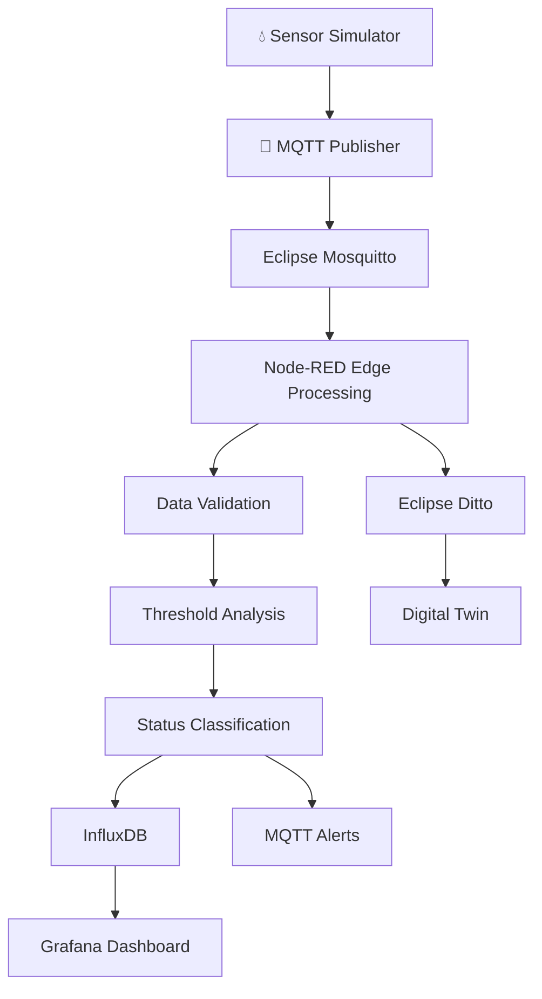

# 💧 AquaTwin — Smart Water Monitoring & Digital Twin

### 🌊 Turning Water Data into Intelligent Decisions

**An IoT-powered water monitoring platform that combines edge computing, real-time analytics, and digital twin technology to detect abnormal water conditions and visualize the health of water tanks.**

<p align="center">

  
  
  
  

</p>

---

## 🌍 The Vision

Water quality monitoring should be more than collecting sensor readings. It should help us understand changing conditions, recognize abnormal measurements, and respond before small problems become serious.

**AquaTwin** explores how IoT messaging, edge processing, time-series databases, interactive dashboards, and digital twins can work together to build a smarter water monitoring system.

The platform simulates water tank measurements, evaluates configurable thresholds, classifies conditions, stores historical data, and represents tank state digitally.

## ✨ Key Features

| Feature | What it does |
|---|---|
| 📡 Real-time Data Pipeline | Transfers sensor measurements through MQTT |
| 🧠 Edge Intelligence | Validates readings and evaluates threshold conditions |
| 🚦 Smart Status Classification | Classifies measurements as SAFE, WARNING, or UNSAFE |
| 🔔 Abnormality Alerts | Generates alerts when configured conditions are met |
| 📈 Historical Analytics | Stores time-series measurements for trend analysis |
| 📊 Interactive Dashboard | Visualizes measurements and water tank conditions |
| 🪞 Digital Twin | Represents each configured tank through a digital model |
| 🐳 Containerized Deployment | Runs the configured services using Docker |
| ⚡ Edge Deployment | Explores Python processing with Eclipse ioFog |

## 🏗️ System Architecture

### From sensor data to digital intelligence



The diagram represents the intended logical workflow. Actual connections depend on the configuration of the deployed services.

## 🔬 What Does AquaTwin Monitor?

Each measurement can contain the following information:

| Parameter | Purpose |
|---|---|
| 🆔 Tank ID | Identifies the monitored tank |
| 🧪 pH Level | Measures acidity or alkalinity |
| 🌫️ Turbidity | Indicates the cloudiness of water |
| 🌡️ Temperature | Tracks water temperature |
| 💦 Water Level | Tracks the tank's water level |
| 🕒 Timestamp | Records when the measurement was captured |

### 🚦 Intelligent Water Status

The system compares incoming readings against configured thresholds.

- 🟢 **SAFE** — Measurements are within configured acceptable limits.
- 🟡 **WARNING** — A warning condition or threshold deviation has been detected.
- 🔴 **UNSAFE** — A configured critical condition has been detected.

*These statuses reflect the software's configured rules. They are not a substitute for laboratory testing or official drinking-water safety certification.*

## 🔄 Two Implementations. One Vision.

### 1. 🐳 Docker-Based Water Monitoring

A containerized monitoring pipeline built around connected services.

- **Mosquitto** — MQTT message broker.
- **Node-RED** — Data processing and workflow orchestration.
- **InfluxDB** — Time-series storage.
- **Grafana** — Monitoring dashboards and historical trends.
- **Eclipse Ditto** — Digital twin representation and APIs.
- **Docker Compose** — Service orchestration.

### 2. ⚡ Eclipse ioFog Edge Computing

An edge-computing implementation exploring local processing through a Python processor managed by Eclipse ioFog.

- Sensor data ingestion through the configured messaging pipeline.
- Local data validation and threshold evaluation.
- Water status classification.
- Alert generation.
- Edge application deployment and management.

The exact data flow and outputs depend on the processor and deployment configuration included in the project.

## 🧰 Technology Stack

<p align="center">

  
  
  
  
  
  
  
  

</p>

## 📂 Repository Structure

```text
Smart_Water_Monitoring/
│
├── smart-water-monitoring/
│   ├── Docker Compose
│   ├── Node-RED flows
│   ├── Mosquitto configuration
│   ├── InfluxDB setup
│   ├── Grafana dashboards
│   └── Eclipse Ditto integration
│
├── smart-water-monitoring-iofog/
│   ├── Python edge processor
│   ├── ioFog deployment configuration
│   ├── Sensor simulation
│   └── Supporting scripts
│
├── .gitignore
└── README.md
```

*This is a conceptual directory overview. Refer to the actual repository files for the exact structure.*

## 🚀 Getting Started

### Prerequisites

- [Docker Desktop](https://www.docker.com/products/docker-desktop/)
- Docker Compose
- Git
- Python, if running the edge processor directly
- A web browser
- cURL or Postman for API testing

### 1. Clone the repository

```bash
git clone https://github.com/LakshmanDev12/Smart_Water_Monitoring-.git
cd Smart_Water_Monitoring-
```

### 2. Choose your implementation

For the Docker-based version:

```bash
cd smart-water-monitoring
```

For the ioFog version, navigate to:

```bash
cd smart-water-monitoring-iofog
```

### 3. Configure the environment

Review the project's configuration files and setup instructions. Configure the required MQTT topics, ports, service credentials, database connections, digital twin identifiers, and threshold values.

Keep passwords, tokens, and other secrets out of GitHub. Use a sanitized `.env.example` file to document required environment variables.

### 4. Start the Docker services

From the directory containing the appropriate Compose file:

```bash
docker compose up -d
```

Verify the services:

```bash
docker compose ps
```

Inspect logs if needed:

```bash
docker compose logs -f
```

### 5. Verify the workflow

1. Start the sensor simulator.
2. Confirm that measurements reach the MQTT broker.
3. Verify processing and status classification.
4. Check that measurements are stored in InfluxDB.
5. Open Grafana and inspect the configured dashboards.
6. Test the digital twin API.
7. For the ioFog implementation, verify the agent and Python processor deployment.

Follow the configuration and port mappings in the selected project folder; exact endpoints may vary.

## 🧪 Testing Scenarios

| Test | Expected behavior |
|---|---|
| Normal measurements | SAFE status when readings satisfy configured rules |
| Warning-level deviation | WARNING status when a warning rule is triggered |
| Critical deviation | UNSAFE status when a critical rule is triggered |
| Invalid measurement | Rejected, flagged, or handled according to validation rules |
| Repeated measurements | Historical records available for trend analysis |
| Tank state update | Digital twin reflects the configured state updates |

## 🌱 Future Enhancements

- 🔌 Integration with physical water-quality sensors.
- 🤖 Machine-learning-based anomaly detection.
- 📱 Mobile alerts and remote monitoring.
- 🔐 Secure device authentication and encrypted communication.
- 🏭 Monitoring multiple tanks across locations.
- 📉 Predictive maintenance and sensor-fault detection.
- ☁️ Cloud deployment and scalable device management.

## 📚 Official Documentation

- [Docker](https://docs.docker.com/)
- [Node-RED](https://nodered.org/docs/)
- [Eclipse Mosquitto](https://mosquitto.org/documentation/)
- [InfluxDB](https://docs.influxdata.com/)
- [Grafana](https://grafana.com/docs/)
- [Eclipse Ditto](https://eclipse.dev/ditto/)
- [Eclipse ioFog](https://iofog.org/)

## 👨‍💻 Project Purpose

AquaTwin demonstrates how IoT messaging, data processing, edge computing, time-series analytics, and digital twin technology can be combined in a water monitoring application.

It is designed as a project for exploring connected systems, operational visibility, and intelligent monitoring workflows.

## 📄 License

A license has not yet been specified. Add an appropriate license before distributing the project, and ensure that third-party components comply with their respective licenses.

---

<p align="center">

  **💧 Monitor Smarter. Detect Earlier. Understand Better.**

  <sub>AquaTwin — Bringing water monitoring and digital intelligence together.</sub>

</p>
